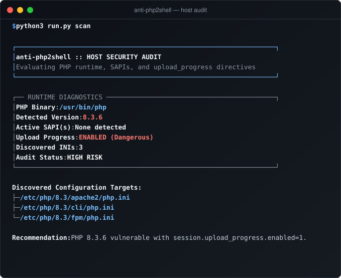

# anti-php2shell

[](https://python.org)
[](https://github.com/yanzyuyu/phptshell)
[](https://github.com/yanzyuyu/phptshell)
[-brightgreen)](https://github.com/yanzyuyu/phptshell)
[](https://github.com/yanzyuyu/phptshell)
[](https://github.com/yanzyuyu/phptshell)
[](LICENSE)

Zero-dependency vulnerability audit, runtime inoculation, and forensic hunter against PHP2Shell (CVE-2026-109618 & CVE-2026-109619).

---

## Operational Reality & Threat Profile

The PHP2Shell vulnerability pair (CVE-2026-109618 and CVE-2026-109619, CVSS v4.0: 9.2 Critical) introduces pre-authentication Remote Code Execution (RCE) across the official PHP core interpreter spanning versions 5.4 through 8.5. The vulnerability stems from heap use-after-free and memory corruption within `ext/session/session.c` triggered during `session.upload_progress` multipart handling.

Because this vulnerability resides in the core runtime binary rather than a userland dependency (e.g., Composer packages), conventional Software Composition Analysis (SCA) and automated dependency scanners fail to detect it. In production environments where compiling or upgrading PHP packages across hundreds of nodes requires scheduled maintenance windows, administrators require immediate runtime assessment, atomic configuration hardening without downtime, and network-level virtual patching.

`anti-php2shell` is built exclusively using Python standard library primitives. It requires zero external dependencies, no compilation, and no `pip install`. All disk operations enforce atomic inode replacement (`os.replace`) with permission preservation (`chmod`/`chown`), pre-flight syntax verification, and a cryptographic transaction ledger for 1-click rollback.

---

## Architectural Capabilities

| Component | Target Mechanism | Operational Guarantee |
| :--- | :--- | :--- |
| **System Auditor (`scan`)** | SAPI discovery, binary inspection, INI parsing | Compares host PHP against official patched thresholds (8.2.35+, 8.3.36+, 8.4.27+, 8.5.12+). Detects Apache `mod_php`, PHP-FPM, and FrankenPHP. |
| **Runtime Inoculator (`vaccine`)** | `session.upload_progress.enabled = 0` | Validates syntax before write. Enforces atomic file replacement with UID/GID preservation and transaction state recording. |
| **Virtual Patch Generator** | Web application firewall rules | Generates drop-in protection rules for Nginx, Apache `.htaccess`, Caddy, and Cloudflare WAF. |
| **Transaction Ledger (`rollback`)** | State rollback via SHA-256 validation | Restores original configurations atomically using pre-mutation checksum verification. |
| **Log Forensic Hunter (`hunt`)** | Access and error log pattern analysis | 64KB chunk-buffered streaming with URL-decode normalization to detect encoded probe strings and worker SIGSEGV crashes. |
| **Endpoint Auditor (`check`)** | HTTP exposure & canary validation | Evaluates public server headers, PHP exposure, WAF layers, and tests upload-progress filtering non-destructively. |

---

## Command Reference & Live Execution



### 1. Host Runtime Audit

Inspect local PHP installations, active SAPIs, and configuration directives:

```bash
$ python3 run.py scan

┌──────────────────────────────────────────────────────────────────┐
│  anti-php2shell :: HOST SECURITY AUDIT                          
│  Evaluating PHP runtime, SAPIs, and upload_progress directives   
└──────────────────────────────────────────────────────────────────┘

┌── RUNTIME DIAGNOSTICS ───────────────────────────────────────────┐
│  PHP Binary           : /usr/bin/php
│  Detected Version     : 8.3.6
│  Active SAPI(s)       : None detected
│  Upload Progress      : ENABLED (Dangerous)
│  Discovered INIs      : 3
│  Audit Status         : [HIGH RISK]
└──────────────────────────────────────────────────────────────────┘

 Discovered Configuration Targets:
  ├─ /etc/php/8.3/apache2/php.ini
  ├─ /etc/php/8.3/cli/php.ini
  └─ /etc/php/8.3/fpm/php.ini

 Recommendation: PHP 8.3.6 vulnerable with session.upload_progress.enabled=1.
```

### 2. Atomic Inoculation & WAF Export

Safely disable `session.upload_progress` across all discovered `php.ini` files with automatic backup and export virtual patch rules:

```bash
$ python3 run.py vaccine --out-dir ./waf-rules

--- ANTI-PHP2SHELL ACTIVE INOCULATION ---
Generating WAF Virtual Patch rules in: ./waf-rules
  [GENERATED] Nginx: waf-rules/nginx_anti_php2shell.conf
  [GENERATED] Apache (.htaccess): waf-rules/apache_anti_php2shell.conf
  [GENERATED] Caddy: waf-rules/caddy_anti_php2shell.snippet
  [GENERATED] Cloudflare WAF Expression: waf-rules/cloudflare_waf_rule.txt

Reminder: Reload your web server or PHP-FPM service to activate changes.
```

To apply inoculation and automatically trigger a graceful service reload via systemd:

```bash
$ sudo python3 run.py vaccine --reload
```

### 3. Automated Configuration Rollback

Restore all modified configuration files to their exact pre-patch state using the transaction ledger:

```bash
$ python3 run.py rollback

--- ANTI-PHP2SHELL ROLLBACK ENGINE ---
[RESTORED] /etc/php/8.3/cli/php.ini: Restored and verified successfully
[RESTORED] /etc/php/8.3/fpm/php.ini: Restored and verified successfully
```

### 4. Forensic Log Inspection

Scan web server access and error logs for attack patterns, heap spraying artifacts, or worker segmentation faults:

```bash
$ python3 run.py hunt --log /var/log/nginx/access.log

--- ANTI-PHP2SHELL FORENSIC LOG HUNTER ---
Inspecting target path: /var/log/nginx/access.log
Lines Scanned: 412,890
Incidents Detected: 3

[INCIDENTS DETECTED]

Breakdown by Category:
  - EXPLOIT_PROBE_UPLOAD_PROGRESS: 3

Top Suspect Source IPs:
  - 198.51.100.24: 3 attempts

Recent Chronological Findings:
  [22/Oct/2026:07:14:02 +0000] [EXPLOIT_PROBE_UPLOAD_PROGRESS] IP: 198.51.100.24 in access.log:4120
```

### 5. Remote Endpoint & Defense Auditor

Inspect external or internal HTTP endpoints for PHP runtime exposure and verify whether WAF virtual patching is active:

```bash
$ python3 run.py check --url https://example.com/app.php

--- ANTI-PHP2SHELL ENDPOINT DEFENSE AUDITOR ---
Target URL: https://example.com/app.php
HTTP Status: 200
Server Header: nginx/1.24.0
PHP Runtime: Hidden / Not exposed
WAF Layer: Cloudflare
Virtual Patch: ACTIVE (Drop upload progress)

Defense Status: [PROTECTED]
Summary: Endpoint is hardened. Virtual patch or WAF is actively dropping PHP2Shell parameters.
```

### 6. Machine-Readable Automation (CI/CD & SIEM)

All subcommands support `--json` for integration into monitoring pipelines, alerting webhooks, or deployment gates:

```bash
$ python3 run.py scan --json
{
  "binary_path": "/usr/bin/php",
  "version": "8.3.6",
  "is_vulnerable": true,
  "upload_progress_enabled": true,
  "active_sapi": [],
  "ini_files": [
    "/etc/php/8.3/apache2/php.ini",
    "/etc/php/8.3/cli/php.ini",
    "/etc/php/8.3/fpm/php.ini"
  ],
  "risk_level": "HIGH",
  "summary": "PHP 8.3.6 vulnerable with session.upload_progress.enabled=1."
}
```

---

## Repository Structure

```
anti-php2shell/
├── anti_php2shell/
│   ├── __init__.py           # Package exports and version metadata
│   ├── checker.py            # HTTP exposure auditor and harmless canary probe
│   ├── cli.py                # Command-line interface and dispatch routing
│   ├── fs.py                 # Atomic file operations and SHA-256 calculation
│   ├── hunter.py             # Log forensic analyzer and stream reader
│   ├── ledger.py             # Transaction tracking and rollback engine
│   ├── scanner.py            # Local SAPI, PHP binary, and INI configuration auditor
│   ├── ui.py                 # Pure ANSI terminal color, card, and banner engine
│   ├── vaccine.py            # In-place INI patcher and WAF rule exporter
│   └── validator.py          # Pre-flight syntax validation engine
├── scripts/
│   └── generate_svg.py       # Zero-dependency terminal screenshot SVG generator
├── tests/
│   ├── test_checker.py       # Unit tests for WAF detection and URL auditor
│   ├── test_fs.py            # Unit tests for atomic file writes and permissions
│   ├── test_hunter.py        # Unit tests for forensic log parser and regex
│   ├── test_ledger.py        # Unit tests for rollback state and checksum validation
│   ├── test_scanner.py       # Unit tests for version matrix and INI parsing
│   ├── test_ui.py            # Unit tests for ANSI styling and badge rendering
│   ├── test_vaccine.py       # Unit tests for inoculation and WAF rule export
│   └── test_validator.py     # Unit tests for syntax validation sandbox
├── waf-rules/                # Exported WAF virtual patch rules (Nginx, Apache, Caddy, CF)
├── terminal_demo.svg         # Dark-mode terminal visual execution screenshot
├── run.py                    # Root CLI entrypoint
├── LICENSE                   # MIT license file
├── README.md                 # Technical documentation
└── .gitignore                # Git ignore rules
```

---

## Verification & Test Suite

Run the test suite using Python's built-in `unittest` framework:

```bash
python3 -m unittest discover -s tests -v
```

All 17 test cases execute deterministically in under 0.2 seconds without external dependencies or network access.
